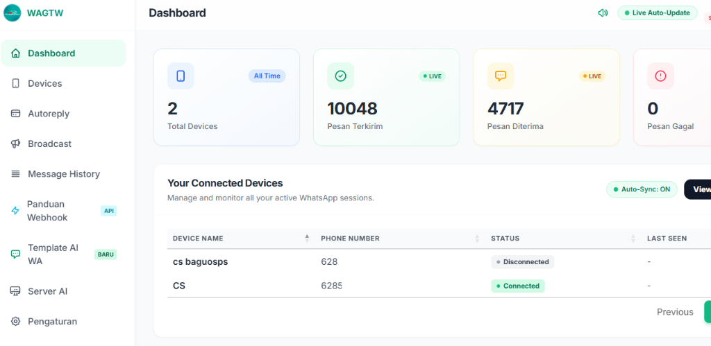

# 🚀 WAGTW - WhatsApp Multi-Device Gateway & AI Marketing Platform


-green?style=flat-square)
-purple?style=flat-square)


<p align="center">
  
</p>

**WAGTW** is a modern, enterprise-grade WhatsApp Gateway and marketing automation platform built with **PHP MVC (Native)** and **Node.js Baileys Engine v7 (pure WebSocket without Chromium/Puppeteer overhead)**. It is extremely lightweight, CPU/RAM efficient, stable, and battle-tested for multi-device management, high-volume broadcasting, intelligent auto-replies, and AI integration (Groq Llama 3) with real-time web search capabilities.

---

## 🎯 Quick Start Guide for Beginners

If you are setting up the project for the first time, follow these **4 simple steps** to get it running locally on XAMPP:

```text
┌─────────────────┐     ┌─────────────────┐     ┌─────────────────┐     ┌─────────────────┐
│ 1. Download /   │ ──> │ 2. Import DB    │ ──> │ 3. Setup .env   │ ──> │ 4. Start Engine │
│    Clone Repo   │     │    database.sql │     │    & npm install│     │    & Launch Web │
└─────────────────┘     └─────────────────┘     └─────────────────┘     └─────────────────┘
```

### Step 1: Download or Clone the Repository
* **Using Git**: Open your terminal/command prompt and run:
  ```bash
  git clone https://github.com/csbaguosps-stack/wagtw.git
  ```
  *(Clone it inside your web server root, e.g., `C:\xampp\htdocs\wagtw`)*
* **Using ZIP**: Click the green **`<> Code`** button on GitHub > select **Download ZIP** > extract the archive into `htdocs/wagtw`.

### Step 2: Import MySQL Database
1. Make sure **Apache** and **MySQL** modules in XAMPP are running (**Start**).
2. Open your web browser and navigate to phpMyAdmin: `http://localhost/phpmyadmin`
3. Create a new database named: `wagtw`
4. Select the `wagtw` database, open the **Import** tab, and choose:
   👉 **`database.sql`** *(located in the project root directory)*
5. Click **Go / Import**.

> 🔑 **Default Super Administrator Credentials**:
> - **Username**: `admin`
> - **Password**: `password`
> *(This account is seeded automatically by `database.sql`)*

### Step 3: Configure `.env` & Install Node.js Dependencies
1. Navigate to the `server` directory:
   - Duplicate `.env.example` and rename it to `.env`.
   - Open `server/.env` and update your database credentials if necessary (default XAMPP has no password):
     ```env
     WA_ENGINE_PORT=3001
     API_SECRET_TOKEN=wagtw_secret_token_2024

     DB_HOST=localhost
     DB_USER=root
     DB_PASS=""
     DB_NAME=wagtw
     ```
2. Ensure you have **Node.js** installed on your system (download from [nodejs.org](https://nodejs.org) if needed).
3. Open terminal/cmd in the `server` directory and run:
   ```cmd
   cd server
   npm install
   ```
   *(Wait until Baileys and Express dependencies finish installing).*

### Step 4: Start Engine & Open the Dashboard
1. **Start the WhatsApp Engine**:
   - Inside the `server` directory, **double-click**:
     👉 **`start_engine.bat`** (or run `node server.js` in terminal).
   - Keep this terminal window open while using WAGTW.
2. **Access Web Dashboard**:
   - Open your browser and go to:
     ```
     http://localhost/wagtw/public
     ```
   - Login with: `admin` / `password`.
3. **Link Your WhatsApp Account**:
   - Go to **Devices** > Click **+ Add Device** > Click **Scan QR**.
   - Open WhatsApp on your phone > **Linked Devices** > **Link a Device** > Scan the QR code on your screen.
   - You're ready to go! Your device is now connected. 🎉

---

## 🧠 System Architecture & Workflow

WAGTW uses a decoupled architecture separating the user-facing web dashboard and the background WhatsApp engine:

```text
  [ User / Administrator ]
          │
          ▼  (HTTP / Browser)
 ┌─────────────────────────────────────────────────────────────┐
 │  PHP MVC Web Application (Port 80 / Apache / Nginx)        │
 │  - Routing: public/index.php -> app/core/App.php            │
 │  - UI: Tailwind CSS, jQuery AJAX SPA (seamless navigation)  │
 │  - Database: MySQL (PDO) persists campaigns, logs, devices  │
 └──────────────────────────────┬──────────────────────────────┘
                                │
                                ▼ (Internal HTTP REST API)
 ┌─────────────────────────────────────────────────────────────┐
 │  Node.js Baileys v7 Engine (Port 3001)                      │
 │  - File: server/server.js                                   │
 │  - Maintains active WhatsApp WebSocket sessions in memory   │
 │  - Handles incoming/outgoing messages, batch queues, alerts │
 │  - Bridges Groq AI (Llama 3) & Real-time Web Search        │
 └──────────────────────────────┬──────────────────────────────┘
                                │
                                ▼ (WebSocket Protocol)
                     [ WhatsApp Servers (Meta) ]
```

---

## 🌟 Key Features

- ⚡ **Ultra-Fast & Lightweight Baileys v7 Engine**: Runs purely via WhatsApp's native WebSocket protocol with full Linked ID (LID) support. Zero Chromium/Puppeteer overhead ensures minimal RAM and CPU utilization.
- 📱 **Multi-Device & Multi-Session**: Connect and operate multiple independent WhatsApp numbers simultaneously from a single dashboard.
- 🤖 **Smart AI Assistant (Groq & Web Search)**: Deep integration with LLaMA 3.3 and Mixtral models, featuring automatic API key rotation, custom business system prompts, and live web browsing (Google, Bing, DuckDuckGo).
- 💬 **Flexible Auto-Responder**: Configure automated replies using exact match, partial contains, regex matching, spintax word spinning, and simulated typing delays.
- 📢 **Smart Broadcast & Anti-Ban Marketing Engine**:
  - Personalized recipient variables (`[Name]`, `[Phone]`, `[Salam]`, `[Date]`, `[Time]`, `[UniqueId]`).
  - Recursive Spintax support (`{Hello|Hi|Greetings}`).
  - Excel (.xlsx, .xls) and CSV contact imports.
  - Multi-layer anti-ban protection with batch pacing and cooling periods.
- 🚫 **Automated Opt-Out & Blacklist Management**:
  - Automatically captures incoming opt-out keywords (`STOP`, `UNSUBSCRIBE`, `BERHENTI`).
  - Instantly blacklists contacts, cancels pending queues, and sends a polite automated confirmation.
  - Converts potential recipient reports into friendly 2-way interactions, preventing 90% of account bans.
- 🌐 **Modern SPA-Like Interface**: Sleek Tailwind CSS design with smooth AJAX partial page updates (no full reloads), responsive modals, DataTables, and SweetAlert2 notifications.
- 🔗 **REST API & Webhooks**: Comprehensive API endpoints for sending text, media, documents, and forwarding incoming messages to your external webhooks.
- 🛡️ **Hardened Security**: Includes strict `.htaccess` rules preventing direct access to core files, script execution prevention in upload folders, and isolated `.env` credentials.

---

## 📁 Directory Structure

```text
wagtw/
├── app/                  # PHP MVC Core
│   ├── config/config.php # Database & auto-detected BASEURL settings
│   ├── controllers/      # MVC Controllers (Auth, Device, Broadcast, AI, etc.)
│   ├── core/             # Framework Core (App router, Controller, Database PDO)
│   ├── models/           # Data models and database queries
│   ├── views/            # UI Views (Tailwind CSS templates)
│   └── .htaccess         # Security: Blocks direct HTTP access to app core
├── assets/               # Documentation & media assets
│   └── img/dashboard.png # Dashboard screenshot
├── public/               # Web Document Root
│   ├── index.php         # Application entry point
│   ├── js/               # main.js (SPA engine) & offline Tailwind CSS
│   ├── templates/        # Broadcast sample template files (CSV & Excel)
│   ├── uploads/          # User uploads directory (secured against webshells)
│   └── .htaccess         # Apache mod_rewrite URL routing
├── server/               # WhatsApp Engine (Node.js)
│   ├── server.js         # REST API server & Baileys WebSocket engine
│   ├── groq.js           # Groq AI chatbot integration helper
│   ├── search.js         # Real-time search engine helper
│   ├── migration.sql     # Database migration schema
│   ├── .env.example      # Environment configuration template
│   └── start_engine.bat  # Auto-restart runner script for Windows
├── database.sql          # Full database schema with seeded Super Admin
├── build_cpanel_zip.bat  # Utility to package clean ZIP for cPanel hosting
├── LICENSE               # MIT License
└── README.md             # Project documentation
```

---

## 📋 System Requirements

Ensure your server or hosting environment meets the following specifications:

| Component | Minimum Specification | Recommended |
| :--- | :--- | :--- |
| **Operating System** | Windows 10/11, Ubuntu 20.04+, Debian 11+ | Ubuntu 22.04 LTS / 24.04 LTS |
| **Web Server** | Apache 2.4+ (`mod_rewrite` enabled) or Nginx | Apache / Nginx |
| **PHP** | PHP 7.4 | PHP 8.1 or PHP 8.2 |
| **PHP Extensions** | `pdo_mysql`, `curl`, `mbstring`, `fileinfo`, `json` | Enabled by default in PHP |
| **Database** | MySQL 5.7+ or MariaDB 10.3+ | MySQL 8.0 / MariaDB 10.6+ |
| **Node.js** | Node.js 20.x LTS | Node.js 22.x LTS (Recommended) |

---

## 🛠️ Node.js Installation Guide

The WhatsApp Engine (`server.js`) requires Node.js. We strongly recommend **Node.js 22.x LTS** for optimum WebSocket stability with Baileys v7.

### A. Windows (Localhost / XAMPP)
1. Visit the official Node.js website: [https://nodejs.org](https://nodejs.org)
2. Download the **LTS (Long Term Support)** installer `.msi` (e.g., `v22.x.x LTS`).
3. Run the installer:
   - Accept the license agreement.
   - Keep default settings and ensure **Add to PATH** is checked.
   - Complete the installation (**Finish**).
4. Verify in **Command Prompt** or **PowerShell**:
   ```cmd
   node -v
   npm -v
   ```

---

### B. Linux (Ubuntu / Debian VPS)
Run the following commands via SSH:

```bash
# 1. Update package list & install prerequisites
sudo apt update && sudo apt install -y curl build-essential

# 2. Add NodeSource Node.js 22.x LTS repository
curl -fsSL https://deb.nodesource.com/setup_22.x | sudo -E bash -

# 3. Install Node.js
sudo apt install -y nodejs

# 4. Verify installation
node -v
npm -v

# 5. Install PM2 (Process Manager to run the engine 24/7 in background)
sudo npm install -g pm2

# 6. Start WAGTW Engine with PM2
cd /path/to/wagtw/server
pm2 start server.js --name wagtw-engine
pm2 save
pm2 startup
```

---

### C. cPanel Hosting (CloudLinux Node.js Selector)
1. Log into your **cPanel** dashboard.
2. Open **Setup Node.js App**.
3. Click **Create Application**:
   - **Node.js version**: Choose `22.x` (Recommended) or `20.x`.
   - **Application mode**: `Production`.
   - **Application root**: `server`.
   - **Application startup file**: `server.js`.
4. Click **Create**.
5. Click **Run NPM Install** to install dependencies.
6. The app will automatically run via Phusion Passenger.

---

## 📱 Feature Guide

### 1. Linking a WhatsApp Account (Scan QR)
1. Go to **Devices** in the sidebar.
2. Click **+ Add Device**, enter a descriptive name (e.g., *Support Hotline*).
3. Click **Scan QR**.
4. Open WhatsApp on your phone:
   - Android: Tap three dots top right > **Linked Devices** > **Link a Device**.
   - iPhone: Settings > **Linked Devices** > **Link a Device**.
5. Point your camera at the QR code on your screen.
6. The status will update to **Connected** automatically.

### 2. Auto-Reply Configuration
1. Go to **Autoreply**.
2. Click **Add Autoreply**:
   - Select the device to respond.
   - Enter your **Trigger Word / Keyword**.
   - Choose matching type: `Exact` (exact match) or `Contains` (substring match).
   - Compose the response message. You can enable typing simulation indicator.
3. Click **Save**.

### 3. Setting Up the AI Smart Assistant
1. Go to **AI Servers**:
   - Enter your Groq API Key (free from [console.groq.com](https://console.groq.com)).
   - Select model (e.g., `llama-3.3-70b-versatile` or `llama3-8b-8192`).
   - Write your custom business instructions / persona.
2. Enable **Web Search** if you want the bot to automatically lookup real-time pricing, news, or search results via Google, Bing, or DuckDuckGo.

### 4. Sending Broadcast Campaigns with Anti-Ban Protection
1. Go to **Broadcast** > **Create Broadcast**.
2. Download the sample Excel/CSV template, paste your contacts, and upload.
3. Write your message using dynamic variables (`[Name]`, `[Salam]`, `[Time]`, `[Date]`, `[UniqueId]`) and Spintax variations `{Hi|Hello|Good day}`.
4. Select a **Security Profile**:
   - 🛡️ **Ultra Safe (Recommended)**: 20-45s delay • 15 messages batch with 10 min cooling period.
   - ⚖️ **Standard**: 15-30s delay • 25 messages batch with 5 min cooling period.
   - ⚡ **Fast**: 10-20s delay (recommended only for existing mutual contacts).
5. Keep **Include Unsubscribe Footer ("Reply STOP")** checked to protect against spam complaints.
6. Click **Launch Broadcast**.

---

## 🔒 Advanced WhatsApp Anti-Ban Architecture

WAGTW implements an advanced 7-layer defense system designed around Meta's automated integrity filters:

1. **Anti-Report Opt-Out System (Primary Ban Defense)**:  
   Over 90% of automated WhatsApp bans occur when recipients tap the *"Report Spam"* button. WAGTW appends a friendly opt-out footer (`Reply STOP to unsubscribe`). When a recipient replies with `STOP` or `UNSUBSCRIBE`:
   - The engine captures the keyword instantly.
   - The phone number is added to `broadcast_blacklists`.
   - All pending broadcasts to that contact are automatically canceled.
   - A polite confirmation message is sent back, establishing a legitimate 2-way conversation that boosts the account's trust score in Meta's algorithm.
2. **Elimination of Bulk `onWhatsApp` Discovery Queries**:  
   Traditional bulk senders repeatedly query `onWhatsApp(jid)` (`usync` IQ query) before sending. Meta flags this pattern as a *Directory Harvesting Attack*. WAGTW dispatches messages directly, letting WhatsApp server validate routing natively and catching errors safely in code.
3. **Official Windows Desktop Browser Signature**:  
   Instead of headless Linux fingerprints (`Ubuntu Chrome 22.04`) that trigger bot detection on cloud VPS servers, WAGTW identifies itself as `Browsers.windows('Desktop')`, identical to official WhatsApp desktop client traffic.
4. **Humanized Presence Flow**:  
   Simulates natural user behavior:
   `Online (available)` ➔ `1.0-2.5s Reading/Opening Delay` ➔ `Typing (composing) proportional to message length` ➔ `Send Message` ➔ `Paused`.
5. **Zero-Width Cryptographic Anti-Hash Watermarking**:  
   Injects invisible zero-width characters into each outgoing message. The message appears identical to human recipients but possesses a unique SHA-256 cryptographic hash, bypassing content-based duplicate spam filters.
6. **Dynamic Delays & Batch Pacing (Cooling Periods)**:  
   Enforces a minimum delay threshold (15s+) supplemented with random Gaussian jitter (±1-2s). Periodic batch cooling breaks prevent velocity threshold triggers.
7. **Circuit Breaker on Consecutive Failures**:  
   If 5 consecutive numbers fail or the session disconnects, the campaign automatically pauses, preventing a bad contact list from damaging your WhatsApp reputation.

---

## ❓ Troubleshooting & FAQ

### Q: QR Code doesn't appear or keeps spinning?
**Cause**: The Node.js WhatsApp Engine (`server.js`) is not running on port 3001.  
**Solution**:
- Ensure `server/start_engine.bat` (or `node server.js`) is running and displays the startup banner.
- On cPanel, verify that the Node.js application status is **Started**.

### Q: 404 Not Found error when clicking sidebar links?
**Cause**: Apache `mod_rewrite` is disabled or `.htaccess` is not being read.  
**Solution**:
- In XAMPP, open `httpd.conf`, search for `LoadModule rewrite_module modules/mod_rewrite.so`, and ensure it is not commented out with `#`.
- Ensure `AllowOverride All` is set for your directory in Apache config.
- Verify that `.htaccess` exists in both root and `public/` directories.

### Q: Database Connection Error?
**Cause**: `server/.env` is missing or MySQL credentials are misconfigured.  
**Solution**:
- Verify `server/.env`. On default XAMPP setups, set `DB_USER=root` and `DB_PASS=""` (empty string).

---

## 📄 License & Attribution

This project is licensed under the **MIT License**.

```text
MIT License
Copyright (c) 2024-2026 cs.baguosps@gmail.com

Coding by: cs.baguosps@gmail.com
Project: WAGTW - WhatsApp Multi-Device Gateway & AI Marketing Platform
```

For technical consultations, custom development, or enterprise support:
- **Email**: [cs.baguosps@gmail.com](mailto:cs.baguosps@gmail.com)
- **GitHub Repository**: [https://github.com/csbaguosps-stack/wagtw](https://github.com/csbaguosps-stack/wagtw)
